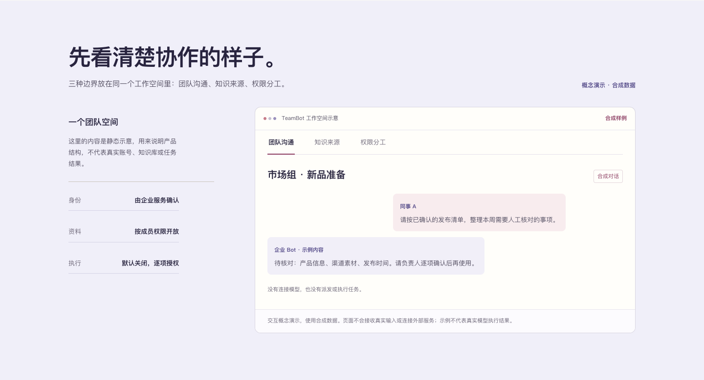
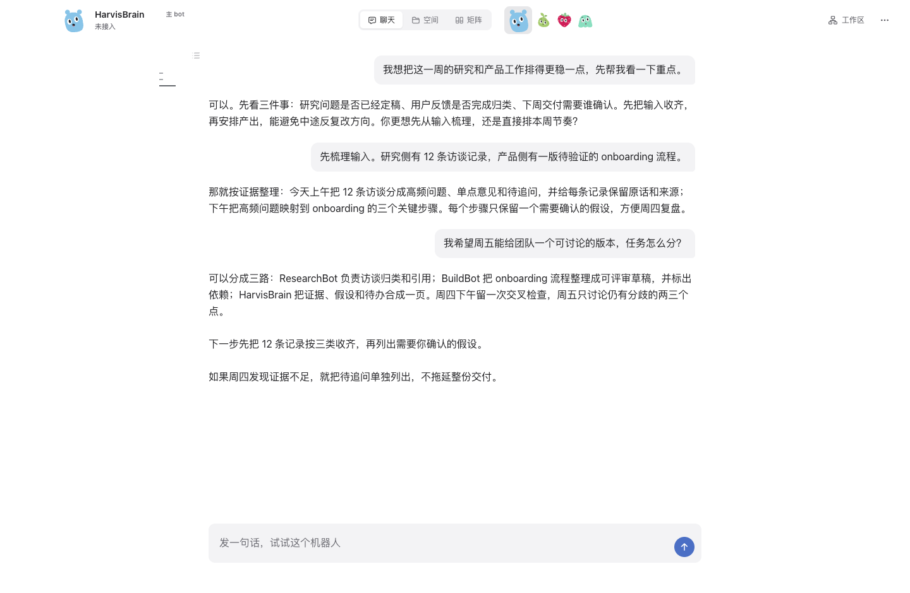
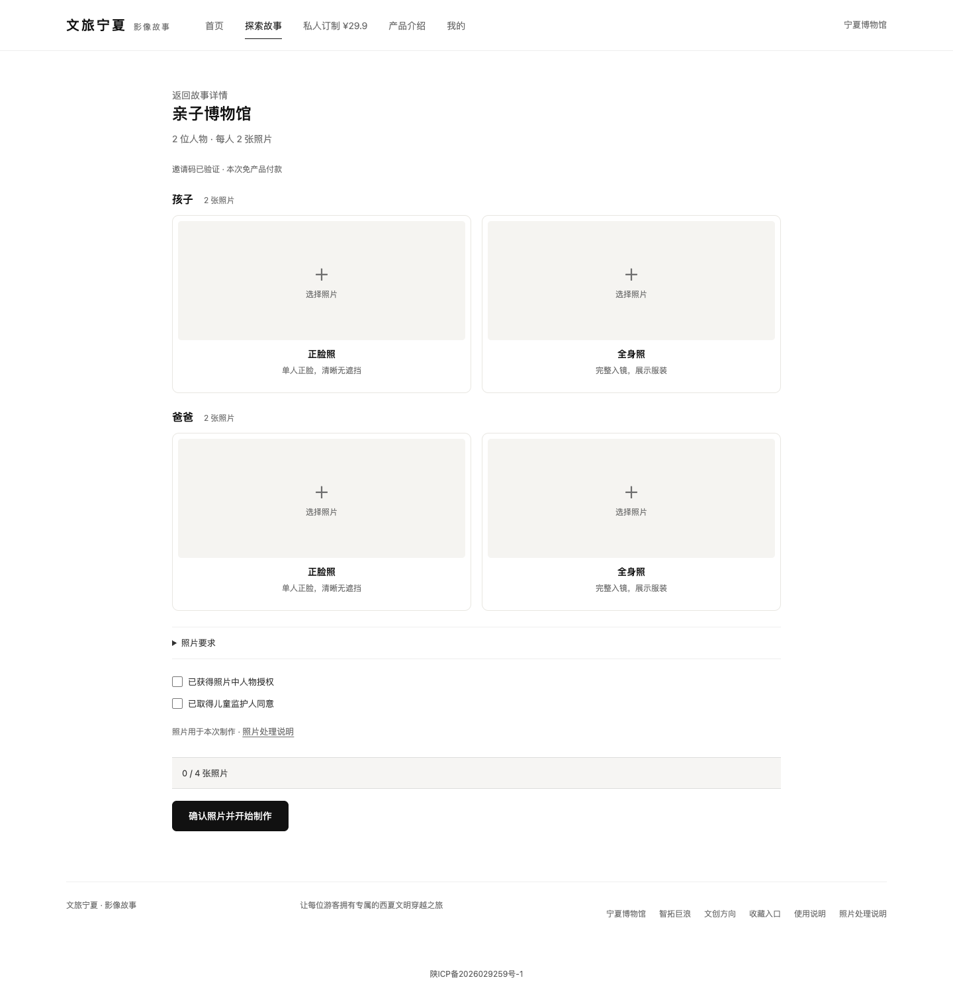
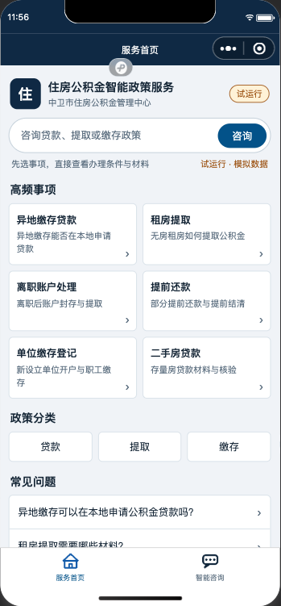
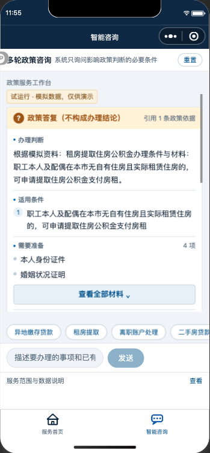

# Harzva.github.io

Full portfolio, paper archive, article collection, and Agent tooling entrance for Harzva.

Live preview: [https://harzva.github.io/](https://harzva.github.io/)

The site now leads with `Make Coding Agents Cheaper`: prompt-cache reuse, trace evaluation, AgentWorkOS, RepoAtlas, Codex hooks, skills, mobile coding workspace, and research proof from VLM / Few-Shot papers.

`DESIGN.md` is the visual and content contract for future agents. Keep this repository as the full archive; the `Harzva` repository remains the lightweight GitHub profile entry card.

## Local Development

```bash
npm install
npm run dev
```

## Build

```bash
npm run build
```

The source of truth is the React code under `src/`. Do not manually edit generated files in `dist/`.


## 实战项目与作品示例

[TeamBot、OpenBot、Wedding、文旅宁夏小程序、ISSHF 公积金 Agent](https://harzva.github.io/#current-projects) · [阿里云项目入口](https://wave.sh.cn/#/projects)

负责这些项目的算法方案设计与全栈研发，覆盖前端、服务端、模型和工具接入、任务运行及部署评测。各项目的具体职责、实现边界与演示见主页。

| 项目 | 核心算法与系统方法 | Agent 落地方式 |
| --- | --- | --- |
| TeamBot | 企业身份 / ACL、任务状态机、租约与审批复核 | 在组织权限内执行、审计和验收；企业试点持续推进 |
| OpenBot | 多 Bot 委派、独立上下文、工具授权、执行器与资源队列 | 从自然语言交办到工具执行、人工接管和结果回写 |
| Wedding | 样片结构化、逐镜头参考约束、双时间轴剪辑、局部修订 | Agent 辅助制作准备，确认后调用生成与剪辑工具 |
| 文旅宁夏 | 固定模板、角色参考绑定、Wan 视频编辑与时间线合成 | 订单驱动的专用生成工作流；制作链不调用 LLM 做自主规划 |
| ISSHF | 同义词归一、关键词与字符 n-gram 检索、RRF 融合、政策版本过滤 | 证据约束的答复 / 追问 / 拒答 / 转人工；模拟资料试用 |

Wedding 提供 Web、macOS 和 Windows 客户端。以下演示展示成片效果；模型能力来自接入的生成模型，方法与系统贡献集中在可控制作和交付流程。

以下为已公开确认的模板样片；点击封面进入个人主页播放器。

[](https://harzva.github.io/#project-wedding)

山顶婚礼 · 婚礼模板 · [直接播放](https://wave.sh.cn/assets/demos/wedding-mountain/film-approved-20261027-c0842a06b34d.mp4)

[](https://harzva.github.io/#project-wedding)

三生三世 · 家中版 · [直接播放](https://wave.sh.cn/assets/demos/wedding-three-lives/film-approved-20261027-918936f194f8.mp4)

### 产品界面

以下为产品界面或明确标注的概念、模拟环境截图，点击图片可查看大图。

**TeamBot**

[](public/project-media/teambot-website-preview.png)

协作概念演示，使用合成数据。


**OpenBot**

[](public/project-media/openbot-chat.png)

OpenBot 产品界面：Bot 对话与工作台。


**文旅宁夏小程序**

[](public/project-media/wenlv-web-companion-make-desktop.png)

配套网页制作界面：角色照片上传与授权确认。


**宁夏公积金 Agent · ISSHF**

[](public/project-media/isshf-simulated-home.png)

小程序首页 · 2026-09-14 开发者工具模拟环境。

[](public/project-media/isshf-simulated-policy-chat.png)

模拟资料答复与政策引用 · 非正式政务服务。
